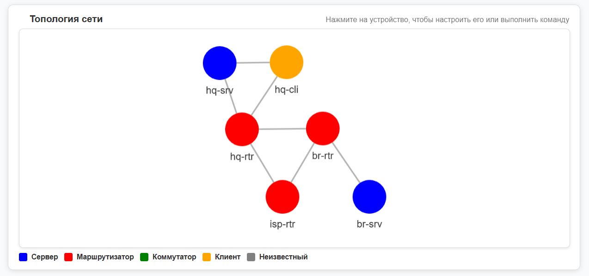
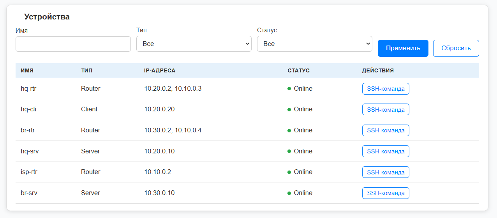
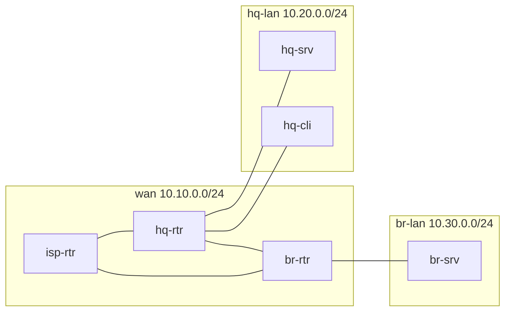

# NetPulse

Веб-приложение для администратора небольшой сети: **обнаруживает устройства по SSH, строит схему топологии
и выполняет типовые команды настройки через интерфейс** вместо ручной работы в консоли.

> Статус: учебный проект. Он начинался как дипломная работа в колледже (2025), затем был
> пересмотрен: исправлены уязвимости, добавлены автотесты и воспроизводимый стенд на Docker.
> Что нашли в коде и что сделали — в [docs/risks.md](docs/risks.md).



## Возможности

- **Обнаружение сети.** Обход по SSH от заданного устройства: имя хоста, интерфейсы (`ip a`), соседи (`arp -an`).
  Тип устройства определяется по ключевым словам в имени (сервер, маршрутизатор, коммутатор, клиент).
- **Схема топологии** с устройствами и связями между ними.
- **Список устройств** со статусом доступности (ping).
- **Шаблоны команд.** Смена IP, пользователи, DHCP/DNS, настройки SSH и другие. Параметры формы проверяются
  (IP-адреса, диапазоны чисел, имена), поэтому в команду нельзя подставить произвольный текст.
- **Произвольная SSH-команда** на выбранном устройстве (для авторизованных пользователей).
- Калькуляторы (подсети, серверы, хранилище), раздел «Полезности» и заметки.

## Быстрый старт (Docker)

Нужны Docker и Docker Compose.

```bash
git clone https://github.com/sophie10741/NetPulse.git
cd NetPulse
docker compose up --build
```

Приложение откроется на `http://localhost:8000` (адрес именно с `http://`). Пароль демо-администратора
создаётся случайным и печатается в логе при первом запуске:

```bash
docker compose logs netpulse | grep администратор
```

### Что попробовать

1. Войдите как `admin`.
2. На главной укажите IP `10.20.0.2` (это `hq-rtr`) и ключевые слова: сервер `srv`, маршрутизатор `rtr`,
   коммутатор `sw`, клиент `cli`. Нажмите «Отсканировать».
3. Через 10–30 секунд появятся шесть устройств и схема их связей.
4. В списке устройств откройте SSH-команду для `hq-srv` и выполните `hostname`.



## Тестовая сеть

Стенд поднимается вместе с приложением: шесть Linux-контейнеров с SSH, объединённых в три сегмента.
Приложение подключено ко всем сегментам и входит на узлы по SSH-ключу, который создаётся при первом запуске.



Ограничения метода: обнаружение идёт по ARP-таблицам и видит только соседей по одному L2-сегменту,
а в Docker сегмент это сеть без коммутатора. Поэтому узлы одного сегмента на схеме связаны между собой.

## Запуск без Docker

Нужен Python 3.12.

```bash
python -m venv .venv
.venv\Scripts\activate          # Linux/macOS: source .venv/bin/activate
pip install -r requirements.txt
cp .env.example .env            # заполните SECRET_KEY
python manage.py migrate
python manage.py createsuperuser
python manage.py runserver
```

Для сканирования нужен SSH-доступ к устройствам: задайте `NETPULSE_SSH_USER`, `NETPULSE_SSH_PASSWORD`
или путь к ключу `SSH_PRIVATE_KEY_PATH` в `.env`.

## Тесты

```bash
python manage.py test
```

Покрыты: модели, проверка параметров шаблонов команд (в том числе попытки внедрения), доступ без входа,
SSH-слой, разбор вывода `ip a` и `arp`, полный сценарий сканирования на подменённом SSH-клиенте.

## Документация

Описание задачи, требования, диаграммы процессов и данных, спецификация API: [docs/](docs/README.md).
Ревью кода с найденными и исправленными проблемами: [docs/risks.md](docs/risks.md).

## Технологии

Python 3.12, Django 5.2, Paramiko (SSH), SQLite, Docker Compose.

## История версий

| Тег | Что это |
|-----|---------|
| `v0.1-diploma` | Исходный дипломный код (секреты вынесены, миграции пересозданы) |
| `v0.2-hardened` | Исправления по ревью кода и автотесты |
| `v0.3-docker-lab` | Воспроизводимый стенд на Docker |

## Безопасность

Демо-режим (`DEBUG`, любой `Host`, шаблон `sudo_no_auth`) предназначен только для лабораторной сети.
Не публикуйте приложение в интернет в таком виде. Открытые вопросы перечислены в [docs/risks.md](docs/risks.md).
