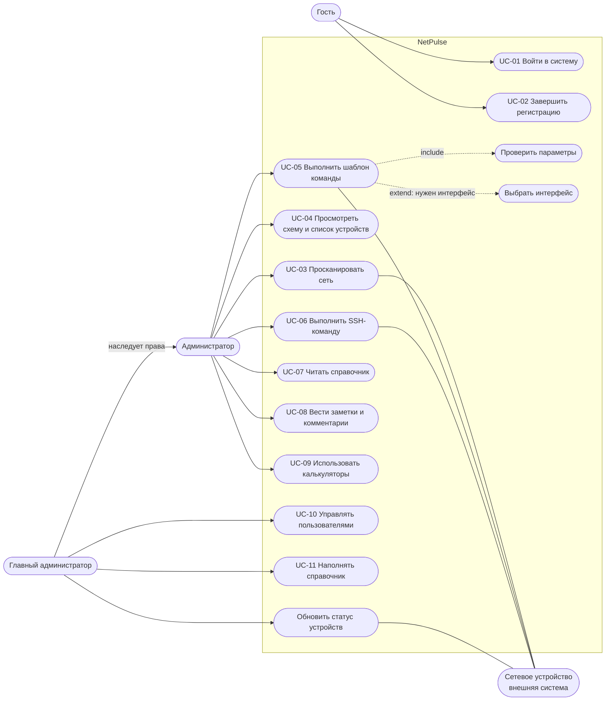

# NetPulse: сценарии использования

Версия 1.0, октябрь 2026.

Сценарий использования (Use Case) — это что-то, что пользователь делает в системе ради понятной цели: «войти», «просканировать сеть», «выполнить шаблон».

## 1. Диаграмма

Как читать: слева — те, кто работает с системой (актёры), внутри рамки — что они могут делать. Главный администратор умеет всё, что умеет администратор.
Пунктир «include» значит «всегда включает», «extend» — «иногда дополняет». Сетевое устройство — внешняя система, с которой NetPulse общается по SSH.

Статус обновляется командой `python manage.py update_status` (вручную или по расписанию). Кнопки в интерфейсе пока нет (FR-12).

## 2. Список сценариев

| ID | Сценарий | Кто | Истории | Требования |
|----|----------|-----|---------|------------|
| UC-01 | Войти в систему | Гость | US-1 | FR-1 |
| UC-02 | Завершить регистрацию | Гость с выданной учётной записью | US-2 | FR-2 |
| UC-03 | Просканировать сеть | Администратор | US-4, US-5, US-6 | FR-5 — FR-9 |
| UC-04 | Просмотреть схему и список устройств | Администратор | US-7, US-8 | FR-10 — FR-12 |
| UC-05 | Выполнить шаблон команды | Администратор | US-9, US-10 | FR-13 — FR-15, FR-17 |
| UC-06 | Выполнить SSH-команду | Администратор | US-11 | FR-16 |
| UC-07 | Читать справочник | Администратор | US-14 | FR-19 |
| UC-08 | Вести заметки и комментарии | Администратор | US-15 | FR-20, FR-21 |
| UC-09 | Использовать калькуляторы | Администратор | US-16 | FR-22 |
| UC-10 | Управлять пользователями | Главный администратор | US-3 | FR-2, FR-3 |
| UC-11 | Наполнять справочник | Главный администратор | US-14 | FR-19 |

## 3. Подробно: основные сценарии

### UC-03. Просканировать сеть

| | |
|---|---|
| Кто | Администратор |
| Цель | Получить схему и список устройств без ручного ввода |
| Что должно быть заранее | Пользователь вошёл; к стартовому устройству есть SSH-доступ по ключу приложения; на узлах Linux с командами `ip` и `arp` |
| Как начинается | Пользователь заполняет форму и нажимает «Отсканировать» |
| Результат | В базе устройства, интерфейсы и связи; на главной схема и таблица |

Основной ход:

1. Пользователь вводит IP стартового устройства и ключевые слова для четырёх типов устройств.
2. Система проверяет IP и то, что слова заполнены.
3. Система запускает обход в фоне и открывает страницу прогресса.
4. Для каждого узла в очереди система подключается по SSH, читает имя хоста, интерфейсы и ARP-таблицу, сохраняет их, добавляет новых соседей в очередь.
5. После обхода система строит связи между устройствами по MAC-адресам.
6. Страница прогресса переходит на главную со схемой и таблицей.

Если что-то пошло не так:

| Шаг | Что случилось | Что делает система |
|-----|---------------|--------------------|
| 2 | IP неверный или слово не заполнено | Возвращает на главную с сообщением, сканирование не запускается |
| 3 | Сканирование уже идёт | Новое не запускает, возвращает на главную |
| 4 | К узлу не удалось подключиться | Пропускает узел (ошибка пишется в журнал сервера), обход продолжается |
| 6 | Ничего не найдено | Показывает стартовую форму без объяснения. Причину должен показывать FR-9 (запланировано) |

После повторного запуска дубликатов устройств, интерфейсов и связей не появляется.

### UC-05. Выполнить шаблон команды

| | |
|---|---|
| Кто | Администратор |
| Цель | Выполнить типовую настройку устройства через форму |
| Что должно быть заранее | Пользователь вошёл; устройство есть в списке и доступно по SSH |
| Как начинается | Пользователь нажимает на устройство на схеме и выбирает шаблон |
| Результат | Команда выполнена, результат показан |

Основной ход:

1. Пользователь выбирает шаблон в меню устройства (набор зависит от типа устройства).
2. Если шаблону нужен интерфейс (смена IP, маршрут по умолчанию), система предлагает выбрать его из списка.
3. Система показывает форму с подсказками к полям.
4. Пользователь заполняет и отправляет форму.
5. Система проверяет каждый параметр, подставляет значения и выполняет команду по SSH.
6. Система показывает вывод или ошибку.

Если что-то пошло не так:

| Шаг | Что случилось | Что делает система |
|-----|---------------|--------------------|
| 5 | Параметр не прошёл проверку | Команду не выполняет, показывает ошибки у полей, введённое (кроме пароля) сохраняет |
| 5 | У устройства нет IP-адреса | Пишет «SSH Error: у устройства нет IP-адреса» |
| 5 | Не удалось подключиться по SSH | Показывает текст ошибки |
| 5 | Запланировано (FR-17) | Перед выполнением покажет итоговую команду с пояснением и попросит подтвердить |

### UC-02. Завершить регистрацию

1. Главный администратор создаёт учётную запись в панели администратора и передаёт логин и пароль.
2. Гость вводит выданные данные, система их проверяет.
3. Гость указывает email, телефон, новый пароль и повторяет его.
4. Если пароли совпадают, система сохраняет данные, и пользователь входит с новым паролем.

Ограничение: сложность нового пароля пока не проверяется (правила Django в этой форме не подключены).

## История изменений

| Версия | Изменение |
|--------|-----------|
| 1.0 | Упрощено, номера историй и требований приведены к новой нумерации |
