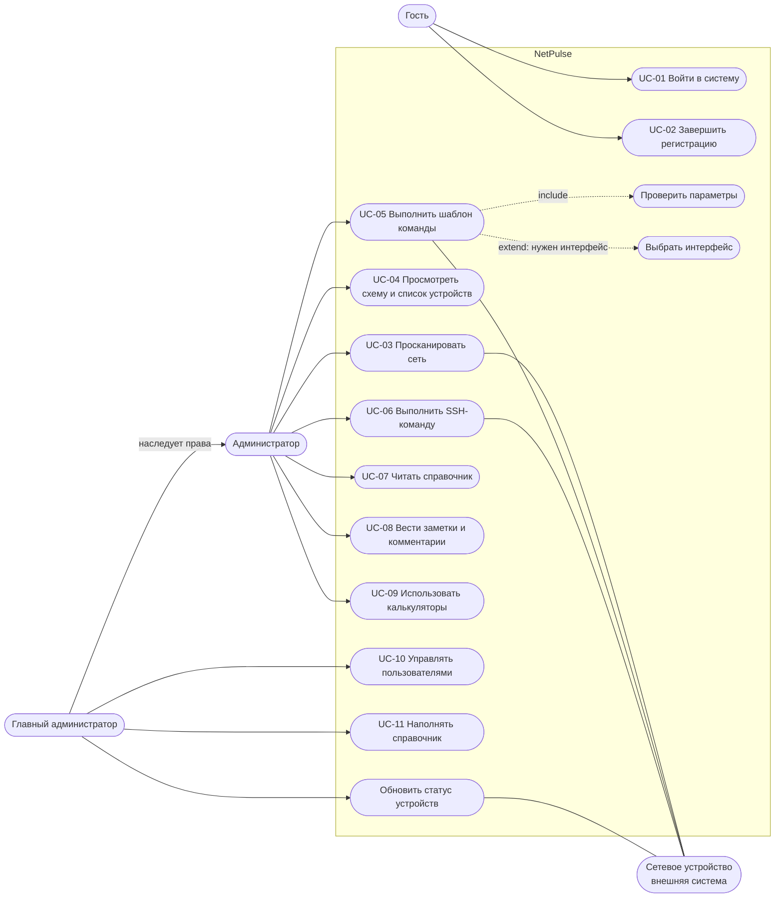

# NetPulse: диаграмма вариантов использования и сценарии

Версия 0.1, октябрь 2026. Источники: документ «Роли и пользовательские истории», «Требования».

## 1. Диаграмма вариантов использования

Диаграмма построена в Mermaid (формат flowchart): актёры слева, границы системы выделены рамкой, пунктир обозначает связи «включает» и «расширяет».
Главный администратор наследует все возможности администратора.

Примечание. «Обновить статус устройств» выполняется командой `python manage.py update_status` (вручную или по расписанию).
Кнопки в интерфейсе пока нет (FR-20).

## 2. Таблица вариантов использования

| ID | Вариант использования | Актёр | Истории | Требования |
|----|-----------------------|-------|---------|------------|
| UC-01 | Войти в систему | Гость | US-01 | FR-01 |
| UC-02 | Завершить регистрацию | Гость с выданной учётной записью | US-02 | FR-02 |
| UC-03 | Просканировать сеть | Администратор | US-10, US-11, US-12 | FR-10 — FR-16 |
| UC-04 | Просмотреть схему и список устройств | Администратор | US-13, US-14 | FR-17, FR-18 |
| UC-05 | Выполнить шаблон команды | Администратор | US-20 — US-24 | FR-30 — FR-33, FR-36 |
| UC-06 | Выполнить SSH-команду | Администратор | US-25 | FR-34 |
| UC-07 | Читать справочник | Администратор | US-40 | FR-40 |
| UC-08 | Вести заметки и комментарии | Администратор | US-42, US-43 | FR-41, FR-42 |
| UC-09 | Использовать калькуляторы | Администратор | US-44 | FR-43 |
| UC-10 | Управлять пользователями | Главный администратор | US-03 | FR-02, FR-03 |
| UC-11 | Наполнять справочник | Главный администратор | US-41 | FR-40 |

## 3. Спецификации ключевых сценариев

### UC-03. Просканировать сеть

| Поле | Содержание |
|------|------------|
| Актёр | Администратор |
| Цель | Получить схему и список устройств сети без ручного ввода |
| Предусловия | Пользователь вошёл в систему. К стартовому устройству есть SSH-доступ по ключу приложения. Узлы — Linux с утилитами `ip` и `arp` |
| Триггер | Пользователь заполняет форму сканирования и нажимает «Отсканировать» |
| Результат | В базе устройства, интерфейсы и связи; на главной схема и таблица |

Основной сценарий:

1. Пользователь вводит IP стартового устройства и ключевые слова для четырёх типов устройств.
2. Система проверяет IP-адрес и что слова указаны для каждого типа.
3. Система запускает обход в фоновом потоке и открывает страницу прогресса.
4. Для каждого узла из очереди система подключается по SSH, читает имя хоста, интерфейсы и ARP-таблицу, сохраняет устройство и интерфейсы, добавляет новых соседей в очередь и записывает связь.
5. После обхода система строит связи между устройствами по MAC-адресам.
6. Страница прогресса переходит на главную, где показаны схема и таблица.

Альтернативные сценарии:

| Шаг | Ситуация | Поведение |
|-----|----------|-----------|
| 2 | IP некорректен или не заполнено слово для типа | Возврат на главную с сообщением об ошибке, сканирование не запускается |
| 3 | Сканирование уже выполняется | Новый запуск не создаётся, пользователь возвращается на главную |
| 4 | К узлу не удаётся подключиться | Узел пропускается (в журнал сервера пишется ошибка), обход продолжается |
| 6 | Ничего не найдено | Главная показывает стартовую форму. Причина пользователю не объясняется (требование FR-15, запланировано) |

Постусловие: повторный запуск не создаёт дубликатов устройств, интерфейсов и связей.

### UC-05. Выполнить шаблон команды

| Поле | Содержание |
|------|------------|
| Актёр | Администратор |
| Цель | Выполнить типовую настройку устройства через форму |
| Предусловия | Пользователь вошёл в систему, устройство есть в списке и доступно по SSH |
| Триггер | Пользователь нажимает на устройство на схеме и выбирает шаблон |
| Результат | Команда выполнена на устройстве, результат показан пользователю |

Основной сценарий:

1. Пользователь выбирает шаблон в меню устройства (набор зависит от типа устройства).
2. Если шаблону нужен интерфейс (смена IP, маршрут по умолчанию), система предлагает выбрать его из списка.
3. Система показывает форму с полями шаблона и подсказками.
4. Пользователь заполняет поля и отправляет форму.
5. Система проверяет каждый параметр (включённый сценарий «Проверить параметры»), подставляет значения и выполняет команду по SSH.
6. Система показывает вывод команды или сообщение об ошибке.

Альтернативные сценарии:

| Шаг | Ситуация | Поведение |
|-----|----------|-----------|
| 5 | Параметр не прошёл проверку | Команда не выполняется, показан список ошибок по полям, введённые значения (кроме пароля) сохранены |
| 5 | У устройства нет IP-адреса | Показано сообщение «SSH Error: у устройства нет IP-адреса» |
| 5 | SSH-подключение не удалось | Показан текст ошибки подключения |
| 5 | Запланировано (FR-36) | Перед выполнением показывается итоговая команда с пояснением и запрашивается подтверждение |

### UC-02. Завершить регистрацию

1. Главный администратор создаёт учётную запись в панели администратора и передаёт логин и пароль.
2. Гость вводит выданные данные; система проверяет их.
3. Гость указывает email, телефон, новый пароль и подтверждение пароля.
4. Если пароли совпадают, система сохраняет данные, и пользователь входит с новым паролем.

Ограничение: надёжность нового пароля не проверяется (встроенные правила Django в этой форме не применяются).

## История изменений

| Версия | Изменение |
|--------|-----------|
| 0.1 | Первый черновик |
