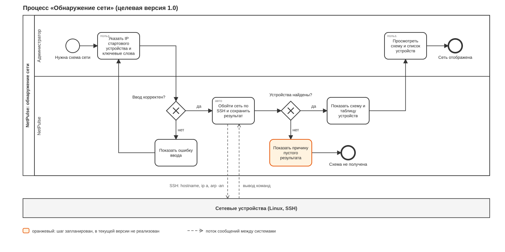
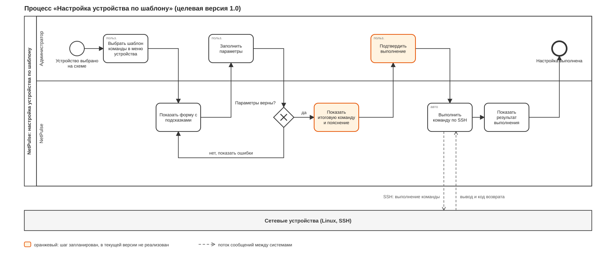

# NetPulse: бизнес-процессы (BPMN)

Версия 0.1, октябрь 2026. Нотация: BPMN 2.0. Модели описывают целевое состояние версии 1.0.

Файлы моделей лежат в `docs/diagrams/`: файлы `.bpmn` открываются и редактируются в [bpmn.io](https://demo.bpmn.io/) (меню «Open») и в Camunda Modeler,
файлы `.svg` показываются прямо на GitHub. Оранжевым выделены шаги, которых ещё нет в текущей версии.
Идентификаторы требований (FR) записаны в поле «Documentation» соответствующих шагов модели.

## 1. Процесс «Обнаружение сети»

Файл модели: [bpmn-discovery.bpmn](diagrams/bpmn-discovery.bpmn)

| Шаг | Исполнитель | Описание | Требования |
|-----|-------------|----------|------------|
| Указать IP стартового устройства и ключевые слова | Администратор | Заполняет форму сканирования | FR-10 |
| Ввод корректен? | NetPulse | Проверка IP-адреса и того, что слова указаны для каждого типа | FR-10 |
| Показать ошибку ввода | NetPulse | Возврат на форму с сообщением | FR-10 |
| Обойти сеть по SSH и сохранить результат | NetPulse (автоматически) | Обход соседей, чтение имени хоста, интерфейсов и ARP-таблицы, сохранение устройств, интерфейсов и связей | FR-11, FR-12 |
| Устройства найдены? | NetPulse | Проверка результата обхода | FR-11 |
| Показать причину пустого результата | NetPulse | Объяснить, почему схема не получена (нет доступа, адрес недоступен, нет соседей). **Запланировано** | FR-15 |
| Показать схему и таблицу устройств | NetPulse | Главная страница со схемой и таблицей | FR-17, FR-18 |
| Просмотреть схему и список устройств | Администратор | Просмотр результата | US-10, US-13 |

Обмен с внешней системой: NetPulse отправляет устройствам команды по SSH (`hostname`, `ip a`, `arp -an`) и получает их вывод.

Исключительные ситуации: устройство недоступно по SSH (узел пропускается, обход продолжается), сканирование уже выполняется (новый запуск не создаётся).

## 2. Процесс «Настройка устройства по шаблону»

Файл модели: [bpmn-configure.bpmn](diagrams/bpmn-configure.bpmn)

| Шаг | Исполнитель | Описание | Требования |
|-----|-------------|----------|------------|
| Выбрать шаблон команды в меню устройства | Администратор | Нажатие на устройство на схеме, выбор шаблона | FR-30 |
| Показать форму с подсказками | NetPulse | Поля шаблона, подсказки к значениям | FR-30, FR-31 |
| Заполнить параметры | Администратор | Ввод значений | US-20, US-22 |
| Параметры верны? | NetPulse | Проверка каждого значения по типу | FR-31, NFR-02 |
| Показать итоговую команду и пояснение | NetPulse | Готовая команда и описание, что она делает. **Запланировано** | FR-36 |
| Подтвердить выполнение | Администратор | Явное подтверждение после просмотра команды. **Запланировано** | FR-36, US-21 |
| Выполнить команду по SSH | NetPulse (автоматически) | Подключение по ключу, выполнение, получение вывода | FR-33 |
| Показать результат выполнения | NetPulse | Вывод команды или текст ошибки | FR-33 |

Ветвление «Параметры верны?»: при ошибке пользователь возвращается к форме, значения сохранены (кроме пароля), рядом показаны причины.

## 3. Различия между текущим и целевым процессом

| Шаг целевого процесса | Текущее состояние |
|-----------------------|-------------------|
| Причина пустого результата сканирования | Нет: пользователь возвращается на стартовую форму без объяснения |
| Показ итоговой команды и подтверждение | Нет: команда выполняется сразу после отправки формы |

Остальные шаги реализованы и покрыты автотестами или проверены вручную (см. «Требования»).

## История изменений

| Версия | Изменение |
|--------|-----------|
| 0.1 | Две модели процессов |
