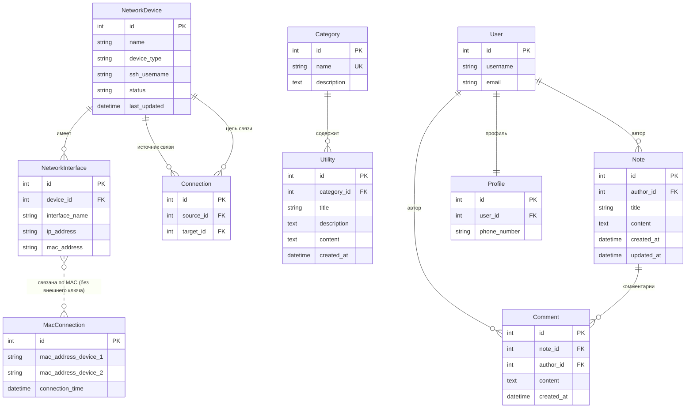

# NetPulse: модель данных

Версия 1.0, октябрь 2026. Модель построена по текущему коду (`monitor/models.py`), а не по пояснительной записке.

## 1. ER-диаграмма

ER-диаграмма показывает таблицы базы и связи между ними. Запись `||--o{` читается как «один ко многим»:
например, у одного устройства может быть много интерфейсов.

`User` — встроенная модель Django (`auth_user`); показаны только используемые поля.

## 2. Что хранится в таблицах

### Устройства и сеть

| Таблица | Поле | Описание |
|---------|------|----------|
| NetworkDevice | name | Имя хоста, полученное при сканировании |
| | device_type | router, server, client, switch или unknown; определяется по ключевым словам в имени |
| | ssh_username | Пользователь для SSH, по умолчанию root |
| | status | online или offline (проверка ping) |
| | last_updated | Время последнего сохранения |
| NetworkInterface | device | Устройство-владелец (при удалении устройства интерфейсы удаляются) |
| | interface_name | Например, eth0 |
| | ip_address | IPv4, может быть пустым |
| | mac_address | MAC в формате xx:xx:xx:xx:xx:xx |
| Connection | source, target | Два устройства, между которыми есть связь; направление отражает лишь порядок обнаружения |
| MacConnection | mac_address_device_1, _2 | Служебная таблица сканера: пары MAC-адресов, увиденных соседями. По ней строятся записи Connection |

У устройства нет столбца IP-адреса: свойство `ip_address` берёт адрес первого интерфейса, у которого он задан.

### Справочник, заметки, пользователи

| Таблица | Поля |
|---------|------|
| Category | name (уникальное), description |
| Utility («полезность») | category, title, description, content (команды и таблицы), created_at |
| Note | author, title, content, created_at, updated_at |
| Comment | note, author, content, created_at |
| Profile | user, phone_number (одна запись на пользователя, создаётся автоматически) |

## 3. Правила целостности

| Правило | Как обеспечивается |
|---------|--------------------|
| Устройство не дублируется при повторном сканировании | Поиск по имени (`get_or_create`) |
| Интерфейс не дублируется | Поиск по IP-адресу перед созданием |
| Связь не дублируется | Проверка пары в обоих направлениях |
| Удаление устройства удаляет его интерфейсы и связи | Каскадное удаление |
| Удаление заметки или автора удаляет комментарии | Каскадное удаление |

## 4. Что можно улучшить

- Устройства различаются по имени хоста, поэтому два узла с одинаковым именем сольются в одну запись. Надёжнее опираться на MAC-адрес.
- На IP-адрес интерфейса нет ограничения уникальности: дубли предотвращает только логика сканера.
- У `MacConnection` нет внешних ключей: сканеру проще, но могут остаться «висящие» записи.
