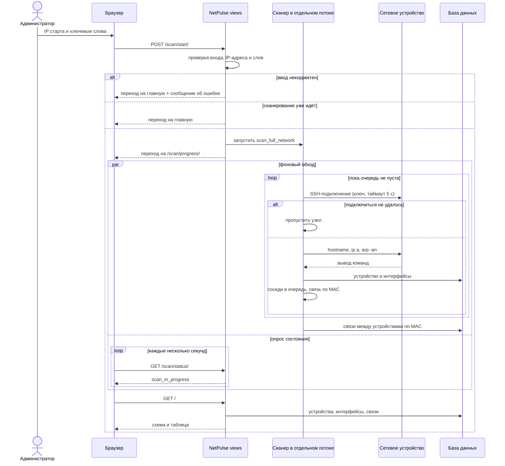
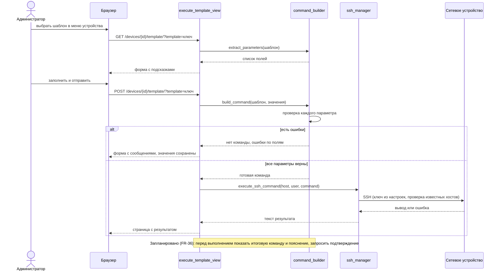
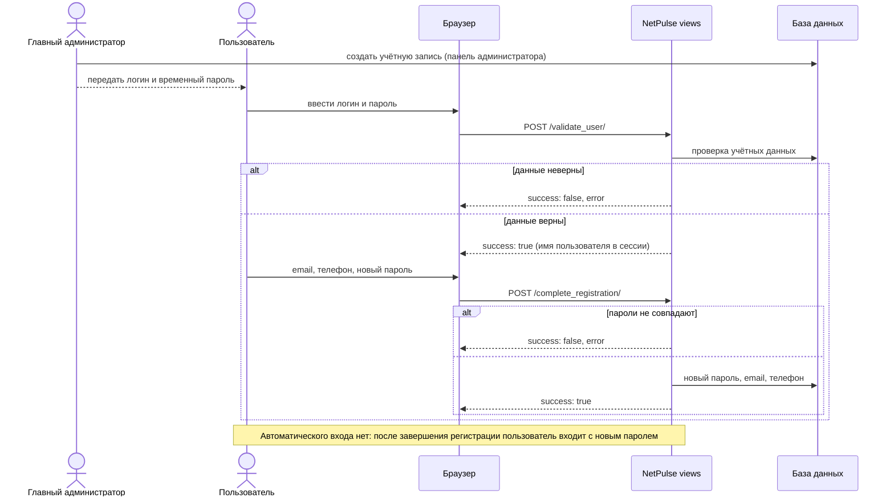

# NetPulse: диаграммы последовательности

Версия 0.1, октябрь 2026. Диаграммы построены в Mermaid и отображаются на GitHub.
Они отражают реальную работу кода (модули `views`, `command_builder`, `ssh_manager`, `network_scanner_1`).

## 1. Сканирование сети

## 2. Выполнение шаблона команды

## 3. Первый вход пользователя

## История изменений

| Версия | Изменение |
|--------|-----------|
| 0.1 | Три диаграммы |
