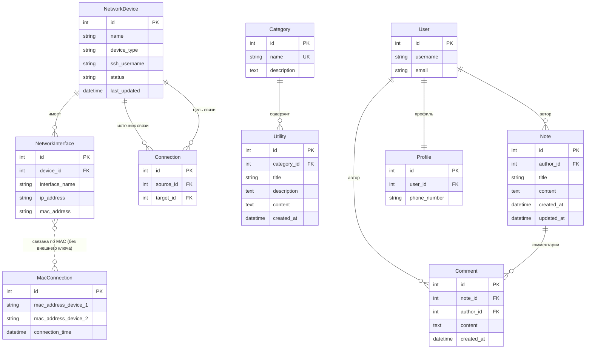

# NetPulse: модель данных

Версия 0.1, октябрь 2026. Модель построена по текущему коду (`monitor/models.py`), а не по пояснительной записке.

## 1. ER-диаграмма

`User` — встроенная модель Django (`auth_user`); показаны только используемые поля.

## 2. Словарь данных

### NetworkDevice (сетевое устройство)

| Поле | Тип | Описание |
|------|-----|----------|
| id | целое, ключ | Идентификатор |
| name | строка до 100 | Имя хоста, полученное при сканировании |
| device_type | router, server, client, switch, unknown | Тип, определяется по ключевым словам в имени |
| ssh_username | строка до 50, по умолчанию root | Пользователь для SSH |
| status | online, offline | Состояние доступности (ping), по умолчанию online |
| last_updated | дата и время | Автоматически при каждом сохранении |

Вычисляемое свойство `ip_address`: адрес первого интерфейса, у которого он задан. В таблице базы такого столбца нет.

### NetworkInterface (сетевой интерфейс)

| Поле | Тип | Описание |
|------|-----|----------|
| device | внешний ключ | Устройство-владелец, каскадное удаление |
| interface_name | строка до 50 | Например, eth0 |
| ip_address | IP-адрес, может быть пустым | Один IPv4 на запись |
| mac_address | строка до 17 | MAC в формате xx:xx:xx:xx:xx:xx |

### Connection (связь устройств)

| Поле | Тип | Описание |
|------|-----|----------|
| source | внешний ключ на устройство | Откуда |
| target | внешний ключ на устройство | Куда |

Связь не направленная по смыслу, направление отражает порядок обнаружения.

### MacConnection (связь по MAC)

Промежуточная таблица, которую заполняет сканер: пара MAC-адресов, увиденных соседями друг у друга. После обхода по ней строятся записи `Connection`.
Внешних ключей нет, связь с интерфейсами идёт по значению MAC.

### Category, Utility (справочник)

| Таблица | Поля |
|---------|------|
| Category | name (уникальное), description |
| Utility | category (внешний ключ), title, description, content (текст команд и таблиц), created_at |

### Note, Comment (заметки)

| Таблица | Поля |
|---------|------|
| Note | author (пользователь), title, content, created_at, updated_at |
| Comment | note, author, content, created_at |

### Profile (профиль)

Одна запись на пользователя (создаётся автоматически), хранит телефон.

## 3. Ограничения целостности и особенности

| Правило | Как обеспечивается |
|---------|--------------------|
| Устройство не дублируется при повторном сканировании | Поиск по имени (`get_or_create`) |
| Интерфейс не дублируется | Поиск по IP-адресу перед созданием |
| Связь не дублируется | Проверка пары в обоих направлениях |
| Удаление устройства удаляет его интерфейсы и связи | Каскад внешних ключей |
| Заметки и комментарии удаляются вместе с автором или заметкой | Каскад внешних ключей |

Наблюдения для развития:

- Уникальность устройства по имени хоста хрупка: два узла с одинаковым именем сольются в одну запись. Устойчивее было бы опираться на MAC-адрес.
- Нет ограничений уникальности на `NetworkInterface.ip_address`, дубли предотвращаются только логикой сканера.
- `MacConnection` без внешних ключей упрощает сканер, но не защищает от «висящих» записей.

## История изменений

| Версия | Изменение |
|--------|-----------|
| 0.1 | ER-диаграмма и словарь данных по текущему коду |
