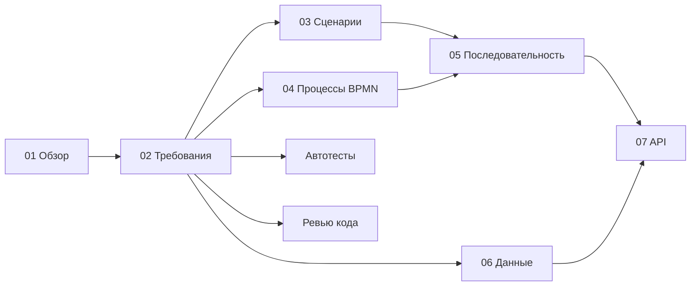

# Документация NetPulse

Здесь собраны документы системного анализа проекта: зачем он нужен, что должен уметь, как устроены его процессы и данные.
Читать можно по порядку или выбрать нужное в таблице.

| № | Документ | Что внутри |
|---|----------|------------|
| 01 | [Обзор проекта](01-overview.md) | Какую проблему решает NetPulse, для кого он, чем отличается от Zabbix и других, что входит в версию 1.0 |
| 02 | [Требования](02-requirements.md) | Пользовательские истории, функциональные и нефункциональные требования и что из них уже сделано |
| 03 | [Сценарии использования](03-use-cases.md) | Диаграмма Use Case и описание основных сценариев по шагам |
| 04 | [Бизнес-процессы (BPMN)](04-processes-bpmn.md) | Две схемы процессов: обнаружение сети и настройка устройства по шаблону |
| 05 | [Диаграммы последовательности](05-sequence.md) | Кто с кем и в каком порядке взаимодействует при сканировании, настройке и первом входе |
| 06 | [Модель данных](06-data-model.md) | ER-диаграмма и описание таблиц базы |
| 07 | [API](07-api.md) | Какие JSON-запросы есть сейчас (OpenAPI, Postman) и как мог бы выглядеть REST API версии 1 |
| — | [Ревью кода](code-review.md) | Какие проблемы нашли в дипломном коде и как их исправили |

Файлы моделей и спецификаций лежат рядом: [diagrams/](diagrams/) (BPMN и картинки SVG), [api/](api/) (OpenAPI и коллекция Postman).

## Как документы связаны между собой

У требований, историй и сценариев сквозные номера (FR, NFR, US, UC). По ним можно пройти от потребности пользователя до
процесса, диаграммы и теста.

## Обозначения

- **US** — пользовательская история (чего хочет пользователь).
- **FR** — функциональное требование (что должна делать система). **NFR** — нефункциональное (как: безопасность, надёжность и т. п.).
- **UC** — сценарий использования.
- ✔ сделано, ◐ сделано частично, ✖ ещё не сделано.
