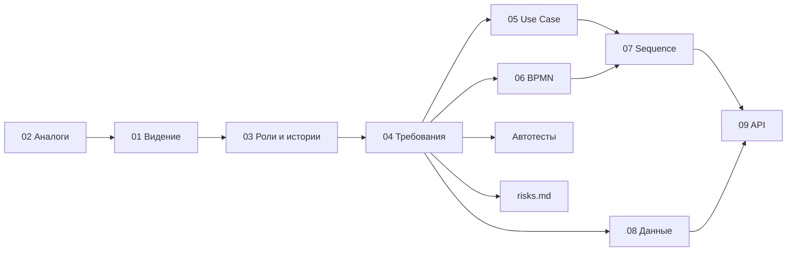

# Документация NetPulse

Документы системного анализа проекта. Основной контекст: учебные лаборатории и малые сети.

| № | Документ | О чём |
|---|----------|-------|
| 01 | [Видение и границы](01-vision-and-scope.md) | Проблема, цели, пользователи, позиционирование, что входит в версию 1.0 и что нет |
| 02 | [Анализ аналогов](02-competitor-analysis.md) | Сравнение с Zabbix, NetBox, AWX/Semaphore, Cockpit/Webmin |
| 03 | [Роли и пользовательские истории](03-roles-and-user-stories.md) | Роли, 24 истории с критериями приёмки, расхождения с ПЗ |
| 04 | [Требования](04-requirements.md) | Функциональные и нефункциональные требования, статусы, проверка |
| 05 | [Варианты использования](05-use-cases.md) | Диаграмма Use Case и спецификации сценариев |
| 06 | [Бизнес-процессы](06-business-processes.md) | Две модели BPMN: обнаружение сети и настройка по шаблону |
| 07 | [Диаграммы последовательности](07-sequence-diagrams.md) | Сканирование, выполнение шаблона, первый вход |
| 08 | [Модель данных](08-data-model.md) | ER-диаграмма и словарь данных |
| 09 | [API](09-api.md) | Текущие JSON-интерфейсы (OpenAPI, Postman) и проект REST API версии 1 |
| — | [Ревью кода](risks.md) | Найденные проблемы, исправления и открытые вопросы |

Файлы моделей и спецификаций: [diagrams/](diagrams/) (BPMN и SVG), [api/](api/) (OpenAPI и коллекция Postman).

## Как связаны документы

Требования (FR, NFR) и истории (US) имеют сквозные идентификаторы: в таблицах указано, какое требование какую историю реализует,
как проверяется (автотест или ручная проверка) и в каком шаге процесса участвует.
